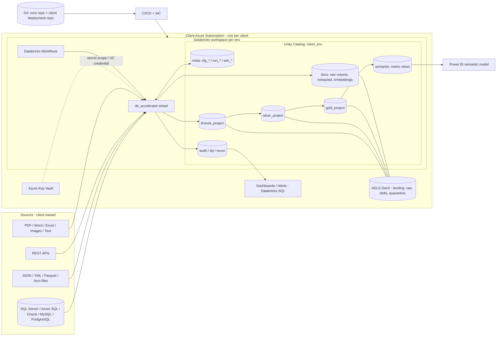
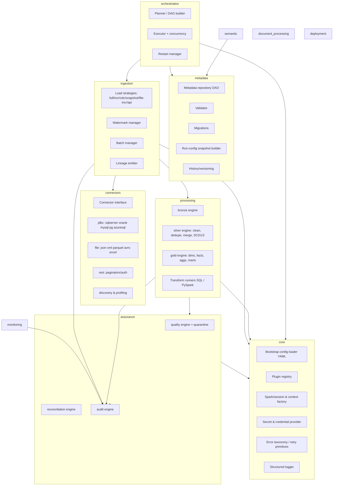
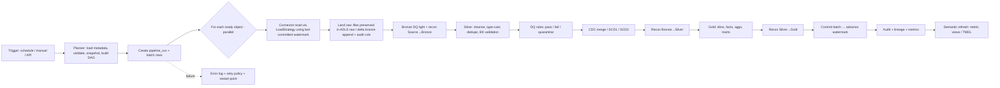

# 01 — Architecture Overview (Deliverables 1–4)

> Status: DESIGN ONLY. Nothing here is implemented.

## 1. Executive architecture overview

The accelerator is a **product**: a versioned Python wheel (`de_accelerator`) plus Databricks Workflow templates, metadata schema migrations and IaC modules. It runs **entirely inside one client's Azure estate**. A run is: *Workflow job → planner reads metadata → freezes a run-config snapshot → executes object tasks (connector → ingest → bronze → silver → gold, with DQ + reconciliation + audit at each boundary) → finalizes*.

Core ideas
1. **Everything is metadata.** What to read, how to load, how to clean, what to check, what to publish is rows in Delta `meta` tables. Code is generic.
2. **Strategy + registry plugin model.** Connectors, load strategies, merge strategies, DQ rule types, recon checks, extractors and transform types register against abstract interfaces. Adding one = adding a module + registration, never editing the engine.
3. **Two-plane separation.** *Configuration plane* (`cfg_*`, versioned, history-tracked, promoted via Git) vs *runtime plane* (`run_*`, `wm_*`, `dq_*`, `rc_*`, append-mostly, owned by engine).
4. **Isolation by deployment, not by tenancy.** No client id crosses an environment boundary; `client_id` columns exist for portability/audit and multi-project clarity only.
5. **Idempotent, restartable units.** Unit of work = *(object, layer, batch)*. Restart re-evaluates state and resumes at the first non-committed stage.
6. **Deterministic runtime; AI only at dev/ops time** (generation, review, failure analysis) with human approval gates.

### Layers of the system
| Plane | Content |
|---|---|
| Control | Metadata engine, config validation, planner, orchestrator, versioning/migration |
| Data | Connectors, ingestion, bronze/silver/gold engines, document pipeline |
| Assurance | DQ, reconciliation, audit/logging, monitoring |
| Consumption | Semantic layer, Databricks SQL views/metric views, Power BI TMDL |
| Platform | Unity Catalog, ADLS, Key Vault, Workflows, IaC, CI/CD |

## 2. High-level architecture diagram

## 3. Detailed component architecture

**Dependency rule:** arrows only point *down/inward*: `orchestration → ingestion/processing → connectors/assurance → metadata/core`. `core` imports nothing from the other packages. Connectors never import ingestion. Enforced by import-linter in CI.

### Key interfaces (contracts, not code)
| Interface | Responsibility | Example impls |
|---|---|---|
| `Connector` | `test()`, `discover()`, `get_schema()`, `profile()`, `read(request)->DataFrame`, `capabilities` | JdbcConnector(dialect), FileConnector(format), RestConnector |
| `LoadStrategy` | Build read request from watermark/batch; declare commit semantic | Full, Incremental, CDC, Snapshot, FileIncremental, ApiPaginated |
| `WriteStrategy` | Append, overwrite-partition, merge (SCD1/2), delete-aware | |
| `DqRule` | `evaluate(df, params)->(violations_df, metrics)` | NullCheck, Unique, Range, Regex, RefInt, Freshness, CustomSql, CustomPySpark |
| `ReconCheck` | `compute(side)`, `compare(a,b,tolerance)` | Count, Sum, Distinct, NullCount, Hash, PK, Financial |
| `Transform` | SQL or PySpark function with declared inputs/outputs | |
| `Extractor` (docs) | text/layout/pages from binary | DocIntel, PdfPlumber, DocxExtractor, OcrImage |
| `SemanticGenerator` | metadata → TMDL / SQL view / metric view | |
| `SecretProvider` | `get(name)` | DatabricksSecretScope(KeyVault), EnvOverride(test only) |
| `OrchestrationProvider` *(Rev 1)* | render/deploy/submit/status/cancel/repair/schedule — see doc 10 §2 | DatabricksWorkflowsProvider (MVP); ADF/Airflow future |
| `OcrProvider` *(Rev 1)* | `analyze(doc)->pages` — doc 10 §4 | AzureDocumentIntelligenceProvider (default) |
| `MetadataReader` / `MetadataService` *(Rev 1)* | read-only typed access / UI-ready façade — doc 09 | Delta, Snapshot, InMemory readers |

> **Rev 1 note:** the "Run-config snapshot" below is realised as an immutable, content-hashed `run_config_snapshot` (doc 09 §6). The data-flow wording "Commit batch → advance watermark" is refined by the manifest/receipt/per-layer-cursor protocol in doc 08. Where wording differs, docs 07–11 prevail.

### Run-config snapshot
At job start the planner materializes a frozen, versioned snapshot (`run_config_snapshot`: JSON per object + `config_version`). Engines read only the snapshot, so mid-run metadata edits cannot create inconsistent runs, and restarts reuse the same snapshot (or an explicit re-plan).

## 4. End-to-end data flow

Watermark advance (step N) happens **only** after the target commit of the stage that owns it (ADR-0004). Quarantined rows are written to `quarantine` tables with `batch_id`, rule id and error detail.
