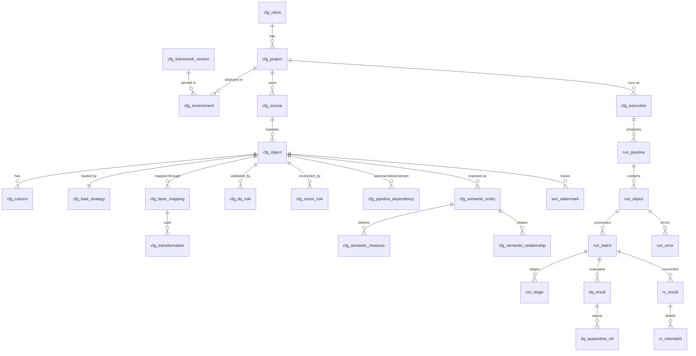

# 02 — Metadata Design (Deliverables 5–6)

> **Rev 1 banner:** The "Versioning" paragraph below (in-place SCD2 on `cfg_*`) is **superseded by ADR-0007 / doc 09**: `cfg_*` rows are insert-only and tagged with `pack_release_id`; "current" = active release via `cfg_active_release` + `v_cfg_*` views; `effective_from/to` derive from release activation. See §Rev1 addendum at the end of this file for added tables.

Catalog `<client>_<env>`, schema `meta`. Naming: `cfg_*` = static configuration (versioned); `run_*`/`wm_*` = runtime state; `*_hist` = history.

## Common columns (all `cfg_*` tables)
`client_id`, `project_id` (where applicable), `env_id` (where env-specific), `config_version` INT, `is_active` BOOL, `effective_from` TIMESTAMP, `effective_to` TIMESTAMP (null = open), `created_by`, `created_ts`, `modified_by`, `modified_ts`, `change_ticket`.
Versioning: a change closes the current row (`effective_to`, `is_active=false`) and inserts a new `config_version`; the engine also appends to `cfg_config_history` (before/after JSON, actor, ticket). Rows are never physically updated in place except by the metadata engine's SCD2 writer.

## ER diagram

## Table definitions (key columns; full DDL in module specs at implementation time)

### Static configuration
| # | Table | PK | Business key | Key columns / FKs |
|---|---|---|---|---|
| 1 | `cfg_client` | client_id | client_code | client_name, tenant_id, region, data_residency, owner_contact |
| 2 | `cfg_project` | project_id | (client_id, project_code) | FK client_id; domain, owner, sla_class, cost_center |
| 3 | `cfg_environment` | env_row_id | (project_id, env_id) | env_id∈DEV/QA/PROD; workspace_url_ref, catalog_name, storage_root, secret_scope, cluster_policy_id, framework_version FK, default_concurrency |
| 4 | `cfg_source` | source_id | (project_id, source_code) | source_type, connector_type, connection_ref (secret keys, never values), auth_mode (MI/SP/secret), options JSON, network_zone |
| 5 | `cfg_object` | object_id | (source_id, schema_name, object_name) | FK source_id; object_kind (table/file/api/doc), target_bronze/silver/gold names, business_keys[], primary_keys[], partition_cols, sensitivity, priority, enabled_layers, delete_mode, tags |
| 6 | `cfg_column` | column_id | (object_id, column_name) | FK object_id; ordinal, source_type, target_type, is_pk, is_bk, is_nullable, is_pii, classification, mask_policy, default_value, cleanse_rules JSON, fk_object_id/fk_column (FK relationships) |
| 7 | `cfg_load_strategy` | load_id | object_id | FK object_id; load_type (FULL/INCREMENTAL/CDC/SNAPSHOT/FILE_INCR/API), watermark_column, watermark_type, lookback_window, cdc_op_column, cdc_seq_column, late_arrival_window, backfill_from/to, schema_evolution_mode, page_config JSON, write_mode |
| 8 | `wm_watermark` *(runtime)* | (object_id, stream_key) | — | committed_value, committed_batch_id, candidate_value, state, updated_ts (see ADR-0004) |
| 9 | `cfg_layer_mapping` | mapping_id | (object_id, layer) | layer BRONZE/SILVER/GOLD, source_ref, target_table, merge_type (APPEND/MERGE/SCD1/SCD2/OVERWRITE), scd_columns, dedupe_keys, dedupe_order, zorder/cluster cols, retention |
| 10 | `cfg_dq_rule` | dq_rule_id | (object_id, rule_code) | rule_type, column(s), params JSON, severity (INFO/WARN/ERROR/CRITICAL), threshold_pct, action (LOG/QUARANTINE/FAIL_BATCH), layer, expression (SQL/PySpark ref), dimension (completeness…) |
| 11 | `cfg_recon_rule` | recon_rule_id | (object_id, recon_code) | scope (SRC_BRZ/BRZ_SLV/SLV_GLD), check_type, left_ref, right_ref, columns, tolerance_abs, tolerance_pct, is_financial, incremental_flag |
| 12 | `cfg_transformation` | transform_id | (mapping_id, step_no) | FK mapping_id; type (SQL/PYSPARK/BUILTIN), body_ref (file path in deployment repo or inline SQL), input_objects, output, params JSON, checksum |
| 13 | `cfg_pipeline_dependency` | dep_id | (object_id, depends_on_object_id) | dependency_type (HARD/SOFT), stage_scope, condition |
| 14 | `cfg_semantic_*` (`entity`, `measure`, `relationship`, `glossary`) | *_id | codes | entity: object_id, entity_type fact/dim, grain; measure: expression, agg_rule, format, is_kpi, kpi_target; relationship: from/to entity+column, cardinality, cross_filter |
| 15 | `cfg_execution` | execution_id | (project_id, exec_code) | scope selector (objects/tags/layers), schedule_ref, concurrency, retry_policy_id, timeout_min, failure_mode (ISOLATE/FAIL_FAST), cluster_profile |
| 15b | `cfg_retry_policy` | retry_policy_id | policy_code | max_attempts, backoff_sec, backoff_mult, retryable_error_classes |
| 16 | `cfg_framework_version` | version_id | semver | metadata_schema_version, min_compatible_schema, release_date, status (ACTIVE/DEPRECATED), wheel_ref |
| 17 | `cfg_config_history` | history_id | — | table_name, key, version_from/to, before_json, after_json, actor, ticket, ts |
| – | `cfg_schema_migration` | migration_id | — | applied_ts, from_ver, to_ver, checksum, status |

### Runtime state (separate schemas: `audit`, `dq`, `recon`)
| Table | Purpose / key columns |
|---|---|
| `run_pipeline` | run_id (PK), execution_id, env_id, trigger_type, framework_version, config_snapshot_id, status, start/end, parent_run_id (restart lineage) |
| `run_object` | run_object_id, run_id, object_id, layer, status, attempt, rows_read/written/rejected, duration_s, error_class |
| `run_batch` | batch_id (PK), object_id, run_id, state (`STARTED→READ→TARGET_COMMITTED→WM_COMMITTED→DONE` / `FAILED`), wm_from, wm_to, source_row_count, restart_of_batch_id |
| `run_stage` | stage-level status for restart: batch_id, stage (EXTRACT, BRONZE, SILVER, GOLD, DQ, RECON), status, delta_version_written |
| `run_attempt` | retry history: attempt_no, error, start/end, retry_reason |
| `run_error` | error_id, class (TRANSIENT/DATA/CONFIG/PLATFORM), message, stack, context JSON |
| `run_lineage` | source_object → bronze → silver → gold edges (+ column-level where available), batch_id |
| `run_schema_snapshot` | object_id, batch_id, schema_hash, schema_json, change_type |
| `run_file_tracking` | file_path, size, mtime, hash, batch_id, status (file-incremental idempotency) |
| `dq_result` | dq_run_id, batch_id, rule_id, status, failed_count, total_count, failed_pct, dq_score |
| `dq_quarantine` | per-object quarantine tables `quarantine.<obj>` with `_dq_rule_id,_dq_error,_batch_id,_row_payload` |
| `rc_result` / `rc_mismatch` | check results with left/right values, delta, tolerance, status; mismatch keys/values |
| `mon_*` | SLA, freshness, anomaly baselines, cost views (derived) |

### Audit columns (Bronze) 
`_batch_id, _run_id, _ingest_ts, _source_system, _source_object, _source_file, _source_file_mod_ts, _row_hash, _op_type (I/U/D/S), _op_seq, _schema_hash, _framework_version`.
Silver adds `_valid_from,_valid_to,_is_current,_is_deleted,_silver_ts,_dq_status`.

## Sample records (synthetic)

`cfg_client`
| client_id | client_code | client_name | region | config_version | is_active |
|---|---|---|---|---|---|
| C001 | ACME | Acme Retail | westeurope | 1 | true |

`cfg_project`: `P001, C001, SALES, domain=Sales, sla_class=GOLD-4h`

`cfg_environment`: `P001, DEV, catalog=acme_dev, secret_scope=kv-acme-dev, framework_version=1.0.0, default_concurrency=8`

`cfg_source`
| source_id | source_code | connector_type | connection_ref | auth_mode |
|---|---|---|---|---|
| S001 | ERP_SQL | sqlserver | `{"host":"kv:erp-host","db":"kv:erp-db","user":"kv:erp-user","pwd":"kv:erp-pwd"}` | secret |

`cfg_object`: `O001, S001, dbo, Orders, business_keys=[OrderID], enabled_layers=B,S,G, delete_mode=soft`

`cfg_load_strategy`: `O001, INCREMENTAL, watermark_column=ModifiedDate, lookback=2h, schema_evolution=ADD_COLUMNS`

`cfg_layer_mapping`
| object_id | layer | target_table | merge_type | dedupe_keys | dedupe_order |
|---|---|---|---|---|---|
| O001 | BRONZE | bronze_sales.erp_orders | APPEND | — | — |
| O001 | SILVER | silver_sales.orders | SCD2 | OrderID | ModifiedDate desc |

`cfg_dq_rule`
| rule_code | rule_type | column | params | severity | threshold_pct | action |
|---|---|---|---|---|---|---|
| ORD_NN_01 | NOT_NULL | OrderID | {} | CRITICAL | 0 | FAIL_BATCH |
| ORD_RNG_01 | RANGE | Amount | {"min":0,"max":1000000} | ERROR | 0.5 | QUARANTINE |

`cfg_recon_rule`: `RC01, SRC_BRZ, COUNT, tolerance_abs=0`; `RC02, BRZ_SLV, SUM(Amount), tolerance_pct=0.001, is_financial=true`

`cfg_pipeline_dependency`: `Silver.Orders depends on Silver.Customers (SOFT)`

`wm_watermark`: `O001, default, committed_value=2026-11-02T23:59:59Z, committed_batch_id=B-20261103-0007`

`cfg_framework_version`: `1.0.0, metadata_schema_version=1, min_compatible_schema=1, ACTIVE`

## Rev 1 addendum — additional tables (DDL in M1; logic in the module that owns them)
| Table | Schema | Purpose | Owner module | M1 status |
|---|---|---|---|---|
| `cfg_pack_release` | meta | release registry: release_id, pack version, git sha, bundle hash, env, status, approver, CI url | metadata | implemented in M1 |
| `cfg_active_release` | meta | per-env active pointer (conditional update, activation_seq) | metadata | M1 |
| `run_config_snapshot` | meta | immutable per-run config snapshot (content hash id) | metadata | M1 |
| `run_batch_manifest`, `run_batch_event`, `run_target_receipt`, `run_batch_lease` | audit | durable batch protocol (doc 08) | ingestion/audit | DDL only in M1 |
| `wm_layer_cursor` | audit | per-layer applied cursor (doc 08) | ingestion | DDL only |
| `cfg_retention_policy`, `cfg_subject_key_map`, `cfg_external_consumer` | meta | retention & erasure mapping (doc 11) | security/gov | DDL + validator rules |
| `gov_erasure_request/task/evidence`, `gov_suppression_list`, `gov_retention_run` | gov | erasure & retention execution evidence | security/gov | DDL only |
| `cfg_doc_pipeline`, `doc_registry`, `doc_page`, `doc_extraction`, `doc_classification` | meta/docs | document path (doc 10 §4) | document_processing | DDL only |
| `cfg_orchestration_provider` | meta | provider selection/options | orchestration | DDL + validator |
| `cfg_semantic_*` additions: `cfg_semantic_target` (SQL_VIEW / METRIC_VIEW / TMDL) | meta | semantic outputs | semantic | DDL + validator |
Notes: env overrides are resolved by the loader (no `cfg_*_override` tables). `cfg_config_history` is derived from release diffs.

## Design notes
- FK relationships between metadata tables are **logical** (Delta/UC informational constraints); integrity enforced by the metadata validator + CI (`cfg` loads fail on dangling refs).
- Secrets: `connection_ref` holds *references* (`kv:<secret-name>`) resolved at runtime; never values.
- `cfg_object` is the grain for orchestration, DQ, recon, restart and lineage.
- Multi-project is native: all keys include `project_id` via source. Env-specific overrides live in `cfg_environment` + optional `cfg_*_override` (env-level override of any param; design pending—flagged in gap analysis).
