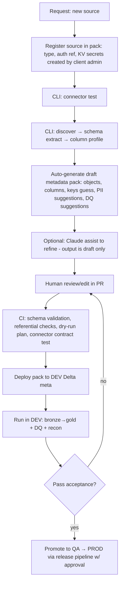
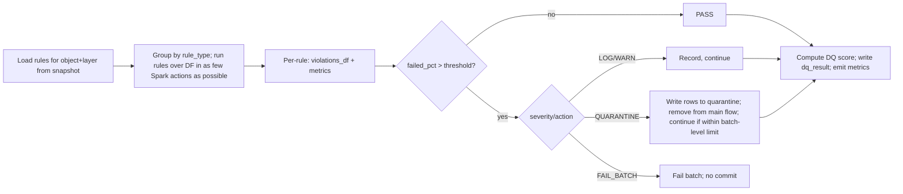

# 04 — Workflows, Execution Flows, Error Handling (Deliverables 9–12, 15)

## 9. Source onboarding workflow

## 10. Client onboarding & deployment workflow
1. Create client deployment repo from `deployment/client_template` (pin core version).
2. Client Azure: IaC (Terraform) creates resource groups, ADLS (containers: landing/raw/delta/quarantine), Key Vault, Databricks workspace, UC metastore assignment, catalogs/schemas, external locations, MI/SP, cluster policies, secret scopes (KV-backed), log analytics, budget alerts.
3. Install wheel to workspace (via Asset Bundle / cluster policy library), publish workflows.
4. `cli migrate` creates `meta` schema + tables at `metadata_schema_version`; registers `cfg_framework_version`.
5. Load bootstrap YAML → seed `cfg_client/project/environment`.
6. Onboard sources (flow 9) per project.
7. Smoke test pipeline (synthetic source) → readiness checklist (security, grants, KV access, network, alerts).
8. Promote DEV→QA→PROD (same artifacts; env-specific values in bootstrap YAML only).

> **Rev 1 notice (doc 08 prevails):** the lifecycle below is strengthened by durable batch manifests (deterministic window fixed before read), append-only batch events, verified target receipts, conditional watermark updates and **per-layer cursors** (source watermark advances after confirmed Bronze commit; Silver/Gold cursors after their own commits). The "crash between target commit and watermark commit" case, restart matrix and the mandatory crash-injection test matrix are specified in doc 08. Flow narratives below remain valid for *what is loaded*, not *how commits are sequenced*.

## 11. Execution flows

### Common batch lifecycle (state machine; basis for restart)
`STARTED → READ → TARGET_COMMITTED → WM_COMMITTED → DONE`   (failure from any state → `FAILED`, restart resumes by state)

### Full load
1. Snapshot config → create batch. 2. Read entire source (partitioned JDBC read when `partition_column` set). 3. Bronze: append with `_batch_id` (or replace via `replaceWhere _batch_id`). 4. Silver: overwrite/merge-with-delete (rows absent in source → soft/hard delete per `delete_mode`, only if full load flagged `is_complete_extract`). 5. Commit; watermark `N/A` (record snapshot timestamp/row count).

### Incremental load
1. Read `committed_value` from `wm_watermark`; query `col > committed - lookback` (lookback handles late-arriving). 2. Compute `candidate = max(col)` from the read data; store as `candidate_value` in batch (NOT committed). 3. Bronze append (idempotent by batch, using Delta `txnAppId/txnVersion` for appends). 4. Silver MERGE on business key with dedupe by order column (latest wins; late rows older than target ignored via `_op_seq/modified` guard). 5. After target commit → `wm_watermark.committed_value = candidate` guarded by `committed_batch_id` precondition; batch → `WM_COMMITTED/DONE`.
 Empty read: batch DONE, watermark unchanged.

### CDC load
1. Source is change feed (op column I/U/D + sequence/LSN) or SQL Server CT/CDC. 2. Read changes with `seq > committed_seq`. 3. Bronze keeps **all** change events (append-only, full history). 4. Silver: per key take latest event by seq within batch (dedupe), `MERGE`: D→soft/hard delete, I/U→upsert; SCD2 variant closes/opens versions using event timestamp, handling out-of-order via seq compare. 5. Advance `committed_seq` post-commit.
 Late/out-of-order: events with seq ≤ target's applied seq for that key are discarded and logged.

### Other strategies
- **Snapshot:** each run lands a dated full copy; Silver diffs vs previous snapshot (hash) to derive I/U/D.
- **File-incremental:** list files > watermark (mtime/name) *not in* `run_file_tracking`; process; mark files `DONE` post-commit (file tracking is the idempotency key; watermark is an optimization).
- **API pagination:** paginator (offset/cursor/link) with page checkpoint in `run_stage`; cursor committed only after the whole extract lands; rate-limit/backoff via retry policy.
- **Backfill/Reprocess:** `cfg_load_strategy.backfill_from/to` or CLI `reprocess --object --from --to`; runs in a separate batch type `BACKFILL` with its own watermark stream key so the live watermark is unaffected; Silver re-merge is idempotent.

## 12. DQ and reconciliation flows

DQ score = weighted pass-rate: `Σ(w_sev × passed_rows_rule)/Σ(w_sev × evaluated_rows_rule)`; default weights INFO 0.5, WARN 1, ERROR 3, CRITICAL 10 (configurable).
Reconciliation: for each `cfg_recon_rule` compute metric on both sides (same filter by `_batch_id` for incremental), compare with abs/% tolerance, write `rc_result`; on mismatch, key-level diff (PK comparison / hash anti-join) into `rc_mismatch`. Failure policy per rule: WARN or FAIL_BATCH (financial rules default FAIL).
Source-side recon queries run pushed-down on the source (count/sum), not a second full read.

## 15. Error handling & recovery design

| Error class | Examples | Handling |
|---|---|---|
| TRANSIENT | network, throttling, cluster loss, 429/503, Delta concurrent write conflict | auto-retry w/ exponential backoff per `cfg_retry_policy`; each retry in `run_attempt` |
| DATA | DQ CRITICAL breach, schema break, malformed file | no retry; quarantine/fail per rule; alert data owner |
| CONFIG | missing metadata, bad expression | fail-fast at plan time (validator) so no data is touched |
| PLATFORM/SECURITY | KV denied, UC permission | no retry; page on-call |
| LOGIC | transform bug | fail object; downstream HARD deps skipped, SOFT continue |

**Failure isolation:** orchestrator marks the failed object `FAILED`; only its HARD descendants → `SKIPPED_UPSTREAM_FAILED`; unrelated branches continue (failure_mode ISOLATE). FAIL_FAST available.
**Restart:** `restart --run-id X [--objects ...] [--from-stage SILVER]`. Restart manager reads `run_batch.state` and `run_stage`; completed stages (verified by recorded Delta version / `txnVersion`) are skipped; first incomplete stage is re-executed idempotently. Batch-level restart re-plans a failed batch using the same `wm_from`; a new run links via `parent_run_id`.
**Crash between target commit and watermark commit:** next run finds batch in `TARGET_COMMITTED` → *completes* the watermark commit rather than re-reading (see ADR-0004).
**Poison-pill protection:** max attempts, circuit-break on repeated schema failure, `quarantine` for bad records, dead-letter folder for bad files.
**Alerting:** failure/SLA breach → Databricks SQL alerts / webhook (Teams/email) from `audit` tables.
