# 09 — Metadata Management Engine: Detailed Design (Rev 1; basis for M1)

## 1. Lifecycle: Git pack → CI → Delta → Snapshot

```mermaid
flowchart LR
  A[Author edits pack in client repo - PR] --> B[CI: lint + JSON-Schema + referential + semantic validation for ALL envs]
  B --> C[Approval: CODEOWNERS / reviewers; AI-authored PR needs label + human approver]
  C --> D[Build pack bundle: resolved per env, manifest.json, sha256 per file, git sha, core-version compat]
  D --> E[Release pipeline per env DEV→QA→PROD with env approvals]
  E --> F[Loader: stage rows tagged pack_release_id, status=STAGED]
  F --> G[Post-load validation in Delta: counts, hashes, FK checks]
  G --> H[Activate: single atomic update of cfg_active_release env pointer]
  H --> I[Run start: planner builds immutable run_config_snapshot]
```

**Atomicity:** rows for a release are inserted under a new `pack_release_id` (invisible, because readers use views joined to the active pointer). Activation = one conditional write to `cfg_active_release` (single-row Delta MERGE/UPDATE). Rollback = pointer flip to previous release (no data rewrite).

## 2. Pack format
- Human-authored **YAML** files (structured by directory), validated by JSON Schema; the *loaded* form in Delta is relational.
- `pack.yaml` (manifest): `pack_name, client_code, pack_version (semver), requires_core: ">=1.0,<2.0", metadata_schema_version, projects[]`.
- Layout: `projects/<project>/{sources,objects,columns,load_strategies,layer_mappings,transformations,dq_rules,recon_rules,dependencies,executions,semantic,retention,subject_keys}/*.yaml`, `overrides/<env>.yaml`, `transform_files/` (SQL/PySpark referenced by checksum).
- Identifiers in packs are **codes** (stable business keys); surrogate ids are generated deterministically (`uuid5(namespace, key path)`) so reloads are stable and diffs are meaningful.
- Secrets appear only as `kv:<name>` references; validator rejects literals matching secret patterns.

## 3. Components (package `de_accelerator.metadata`)
| Module | Responsibility | Key interface |
|---|---|---|
| `schema/` | DDL definitions (versioned), JSON-Schemas, column type registry | `TableSpec`, `SchemaVersion` |
| `migrations/` | ordered idempotent up/down scripts, checksums, `cfg_schema_migration` | `Migrator.plan/apply/rollback` |
| `packs/` | pack discovery, parsing, env override resolution, deterministic ids, bundle build | `PackReader`, `PackBundle` |
| `validation/` | validation pipeline (see §4) with structured results | `ConfigValidator.validate(bundle, env) → ValidationReport` |
| `loader/` | stage → verify → activate/rollback | `PackLoader.stage/activate/rollback` |
| `versioning/` | releases, active pointer, compatibility check, history/diff | `ReleaseManager` |
| `snapshot/` | build, hash, persist, verify immutable run snapshots | `SnapshotBuilder`, `SnapshotStore` |
| `reader/` | read-only typed access to active config / snapshots | `MetadataReader` (Delta impl + in-memory impl for tests) |
| `history/` | `cfg_config_history` population via release diffs | `ChangeDiffer` |
| `service/` | UI-ready façade (see doc 10 §6): validate, diff, propose, query — no direct writes | `MetadataService` |
Rules: only `loader` writes `cfg_*`; engines get `MetadataReader` only. Framework runtime identity has no write grant on `cfg_*`.

## 4. Validation layers (all produce stable error codes `MDV-nnnn`)
1. **Syntax/schema:** YAML parse, JSON-Schema (types, enums, required, patterns).
2. **Referential:** every FK resolves (object→source, column→object, dq→column, mapping→object, dependency endpoints, semantic→gold objects); no orphans; unique business keys.
3. **Semantic:** e.g. incremental needs watermark column; CDC needs op/seq columns; SCD2 needs business keys + tracked cols; PK/BK columns exist in `cfg_column`; layer mappings form a valid chain; DAG acyclic; DQ rule params valid for rule type (checked against rule-type registry); thresholds in [0,100]; recon scopes valid; retention/erasure subject keys present for PII objects.
4. **Policy:** secrets are `kv:` refs; PII columns have classification and (if configured) mask policy; PROD packs reject `FAIL_FAST` disabled-audit settings, etc. Policy set is configurable per client.
5. **Compatibility:** `requires_core` satisfied by installed version; `metadata_schema_version` ≤ deployed; deprecated keys warned.
6. **Environment:** validation run per env after override resolution.
7. **Plan-time (runtime, optional):** connector registered for each `connector_type`, transform files exist/checksum match (needs registry ⇒ executed by planner, not M1 CI; M1 exposes the hook).
Output: `ValidationReport{errors, warnings, info, stats}` JSON + human text; non-zero exit on errors.

## 5. Versioning & history
- `cfg_pack_release`: `release_id` (uuid), `pack_name, pack_version, git_sha, git_tag, bundle_sha256, env_id, status (STAGED/ACTIVE/SUPERSEDED/ROLLED_BACK/FAILED), approved_by, ci_run_url, core_version_at_load, staged_ts, activated_ts`.
- `cfg_active_release(env_id, release_id, previous_release_id, activated_by, activated_ts, activation_seq)` — conditional on `activation_seq` (optimistic).
- Immutability: all `cfg_*` rows insert-only (table property `delta.appendOnly=true` on cfg tables; UC grants deny UPDATE/DELETE to everything but a dedicated loader principal that has INSERT only; pointer table is the only updatable one). Retention of old releases per policy; never physically deleted without an audited admin procedure.
- `cfg_config_history` is derived by `ChangeDiffer` between consecutive releases (row-level before/after JSON, actor from PR approver, ticket).

## 6. Immutable run snapshots
- `run_config_snapshot(snapshot_id, release_id, execution_id, scope_json, content_sha256, content_json (or ADLS path), created_ts, created_by_run_id, framework_version)`.
- `snapshot_id = sha256(canonical_json(resolved config of the selected scope))` → identical configs dedupe; every pipeline run references one `snapshot_id`.
- Canonical JSON: sorted keys, normalized types/timestamps, no volatile fields. Builder resolves *all* config needed (objects, columns, loads, mappings, DQ, recon, deps, retention, transform file checksums) so runtime never queries `cfg_*` again.
- Immutability: append-only table, content hash verified on every load (`SnapshotIntegrityError` on mismatch); restart uses the same `snapshot_id` unless operator requests `--replan` (new snapshot, audited).
- Snapshot retention ≥ longest of: audit retention, restart horizon.

## 7. Reader contract
`MetadataReader`: `get_active_release(env)`, `get_snapshot(id)`, `list_objects(filter)`, `get_object(object_id)` (typed dataclasses: `ObjectConfig`, `ColumnConfig`, `LoadStrategyConfig` …), `get_dq_rules(object, layer)`, `get_dependencies()`, `diff(release_a, release_b)`. Implementations: `DeltaMetadataReader` (Spark, reads through active-release views), `SnapshotMetadataReader` (reads a snapshot JSON, no Spark needed — used by engines), `InMemoryMetadataReader` (tests). Reads are cached per run; no network calls in snapshot mode.

## 8. Security
Loader principal: INSERT on `cfg_*`, UPDATE on pointer only; engine principal: SELECT on views, INSERT on `run_*`; humans: SELECT only. Pack bundle checksum verified before load; Git commit signing recommended; no PII in metadata (organizational policy) — validator flags suspicious sample values in `description/default` fields.

## 9. Failure handling
Validation fail ⇒ no load. Stage failure ⇒ release `FAILED`, pointer untouched. Activation conflict ⇒ retry/abort with clear message. Partial staging is invisible. Re-running loader with same bundle hash is idempotent (no duplicate release).
