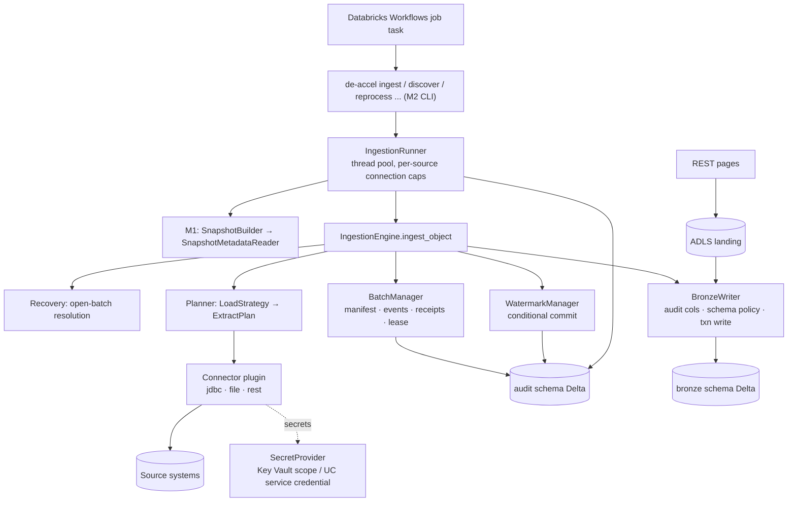

# M2 — Source-to-Bronze Ingestion Engine: Architecture, Scope and Gap Analysis

**Status: PROPOSED DESIGN — awaiting your review. No M2 code exists.** Baseline: M1 (LOCAL_VERIFIED, 8 schemas / 53 tables / 22 schema-only), Rev 1 docs 01–13, ADR-0001…0018.
Reviewed for this design: docs 01, 02, 04, 08, 09, 10, 11; M1 entities (`schema/entities.py`), table specs (`schema/tables.py`), release/snapshot/reader APIs, CLI, validator rules.

## 1. Objective and scope
Extract data from real source systems and land it durably, idempotently and restartably in the Databricks **Bronze** layer, driven only by M1 metadata.

| In M2 | Out of M2 (later milestone) |
|---|---|
| Connectors: SQL Server, Azure SQL, PostgreSQL, CSV, JSON, Parquet, REST | Oracle, MySQL, Avro, XML, Excel, documents (V1) |
| Loads: full, incremental, CDC (incl. deletes), snapshot, file-incremental, API pagination | Silver/Gold, merge/SCD (M3), per-layer cursors for Silver/Gold (M3) |
| Source-to-Bronze with audit columns, schema evolution, idempotent writes | DQ, reconciliation engines (M4) — M2 only records counts |
| Batch manifest, receipts, source watermark, crash recovery, retry, reprocess | Planner/DAG/`for_each` orchestration, provider interface impl (M4) |
| Schema discovery, profiling, metadata auto-generation (draft packs) | Terraform, monitoring dashboards, cost views (M5/M6) |
| Key Vault + Managed Identity credential resolution | Document OCR/RAG, `docs` schema (future) |

## 2. Architecture

Code layout (new packages; M1 packages untouched except two additive changes in §5):
`de_accelerator/connectors/{base,jdbc,files,rest,discovery}`, `ingestion/{engine,strategies,planner,recovery,runner}`, `processing/bronze/{writer,schema_policy,audit_columns}`, `audit/{manifest,events,receipts,watermark,lease,logging}`, `core/secrets.py`, `core/faults.py` (test-only injector), `cli/ingest.py`.

**Dependency rule (enforced by import-linter):** `cli → ingestion → connectors/processing/audit → metadata(reader/models only) → core`. Connectors never import ingestion; ingestion never imports a concrete connector (registry only).

### Design principles applied
Metadata-driven (nothing source-specific in engine code) · one engine, plugin connectors · deterministic replay (plan-before-read) · effectively-once Bronze (idempotent write + verified receipt + conditional watermark) · Bronze keeps raw history; cleansing/dedupe belong to Silver · no new infrastructure (Delta tables only, no queues/brokers) · reuse M1 readers, snapshot, store, errors, redaction, naming, CLI.

## 3. How M2 reuses M1 (no rewrite)
| M1 asset | M2 use |
|---|---|
| `SnapshotBuilder` / `SnapshotStore` / `SnapshotMetadataReader` | Runner builds one snapshot per execution (scope = `cfg_execution`); every batch stores `snapshot_id` + `release_id`; recovery reloads the **manifest's** snapshot, so a config release activated mid-batch never changes an in-flight batch |
| Typed models (`ObjectConfig`, `SourceConfig`, `LoadStrategyConfig`, `ColumnConfig`, `EnvironmentConfig`, `RetryPolicyConfig`) | Passed to connectors/strategies as immutable inputs |
| `TableStore` (`insert_if_absent`, atomic `update_where`) | All audit-table access (manifest insert-once, conditional watermark) |
| `core.errors` taxonomy + `error_class` | Retry classification (`cfg_retry_policy.retryable_error_classes`) |
| `core.logging.redact`, `kv:` reference convention | No secret ever logged/stored; manifests hold references only |
| `core.naming` (`<client>_<env>`, schemas) | Bronze table = `<catalog>.bronze.<table>` |
| `de-accel` CLI + `--bootstrap` + injectable store | New sub-commands |
| 22 `DDL_ONLY` audit/gov tables | Activated (logic added) — see §5 for the small additive changes |
| Validator + rule registry | Extended with a connector-validation hook and a few rules |
| `FaultyStore` crash-injection pattern (tests) | Generalised into `core/faults.py` + Bronze crash matrix |

## 4. Ingestion execution model (MVP)
`IngestionRunner` = one process (local, or one Databricks job task). It builds the snapshot, selects objects (execution scope / `--objects`), and runs `ingest_object()` for each in a thread pool (`cfg_execution.concurrency`), with per-source connection caps (`cfg_source.options.max_connections`). Objects are independent: one failure never stops others. `ingest_object()` is a pure function of (snapshot, object code, run id, store, spark) — the M4 planner/`for_each` orchestration will call the same function, so nothing is thrown away. Details in `05_errors_security_orchestration_local.md`.

## 5. Gaps and conflicts with M1 (and proposed resolutions)
| # | Finding | Impact | Proposed resolution (needs your approval) |
|---|---|---|---|
| G1 | `cfg_load_strategy` has no place for connector-specific read settings (file path/glob/format options, API endpoint/records path, CDC table) and no CDC op-code mapping (`cdc_op_column` exists, but values like `1/2/3/4`, `c/u/d` need mapping) | Blocks files, REST, CDC | **CR-M2-01:** additive migration `0002`: `cfg_load_strategy.read_options json`, `cfg_load_strategy.cdc_op_map json`; update `entities.py` (pack schema, typed models regenerate automatically). Expand-only, backward compatible; existing packs stay valid |
| G2 | Validator knows nothing connector-specific (e.g., required `connection` keys per source type, `read_options` keys) | Bad configs fail at runtime, not CI | **CR-M2-01:** add a `ConnectorValidator` hook in `validation/engine.py` (rules `MDV-6xxx`), implemented by each connector; no change to existing 60 rules |
| G3 | `source_type` (enum) vs `connector_type` (free text) overlap | Ambiguous registry key | Registry key = `source_type`; `connector_type` is informational family (`jdbc`/`file`/`rest`); new rule MDV-6001 requires them consistent |
| G4 | `target_bronze` is stored as `bronze.erp_orders` (schema-qualified) | Catalog/schema must come from naming helper | Bronze writer parses `schema.table`, requires schema == `bronze`, qualifies with catalog; new rule MDV-6002 |
| G5 | Reserved audit column names (`_batch_id`, …) can collide with source columns | Silent corruption | New rule MDV-6003: declared source columns must not start with `_`; runtime check on discovered schema too |
| G6 | DDL_ONLY audit tables lack a few columns the design needs (`run_batch_manifest`: `release_id`, `plan_json`; `run_target_receipt`: `txn_app_id`, `txn_version`, `rows_read`; `wm_watermark`: `epoch`) and `run_file_tracking` PK `(object_code, file_path)` cannot represent a re-delivered file with new content | Re-delivered files missed/duplicated | **CR-M2-01** (same migration 0002): additive columns; tracking key becomes `(object_code, file_path, mtime, size)` (informational PK; enforced via `insert_if_absent` keys) |
| G7 | Doc 08 says the manifest fixes `wm_to` **before** the read and `batch_seq = committed_seq + 1` | True for JDBC/files/CDC. **REST APIs cannot know `wm_to` before reading**; and an *abandoned* batch consumes a sequence number | Refinements (no baseline change): (a) REST uses **landing-first + sealed extraction event** (`EXTRACTION_SEALED` with landed-file checksum and observed max watermark) — durable and immutable, equivalent guarantee; (b) `next_seq = max(manifest seq) + 1`; contiguity (I7) applies to *committed* batches. Documented in ADR-0019 |
| G8 | Roadmap places orchestration in M4, but "extract real data now" needs a runnable job | Scope ambiguity | M2 delivers a minimal **runner + Workflows job template** (no planner/DAG); M4 adds dependency graph, `for_each`, provider interface. Same `ingest_object()` underneath |
| G9 | Doc 08 per-layer cursors: only the **source watermark** is relevant to M2 | none | `wm_layer_cursor` stays DDL_ONLY until M3. Multi-stream ordering (live/backfill/reprocess) for Silver is an explicit **M3 dependency** (Bronze carries `_stream_key`, `_batch_seq`, `_batch_type` to make it possible) |
| G10 | Spike S1 (MERGE tagging) in doc 08 is for Silver | none for M2 | M2 uses append only. **Local spike done** (this design): Delta idempotent append (`txnAppId/txnVersion`) skips replays and stale versions, history exposes `userMetadata` + `numOutputRows`, column mapping works (Delta 3.2). **Must be re-verified on the target Databricks runtime** (pending) |
| G11 | Source-connection capacity governance (doc 06 gap #7) | Source overload | `cfg_source.options.max_connections` + runner semaphore per source (no schema change) |
| G12 | No `SecretProvider` yet; `dbutils` is unavailable locally | Cannot resolve `kv:` refs | `core/secrets.py` (interface + Databricks-scope impl + local env impl guarded against PROD) |
| G13 | Docker daemon not available in this sandbox | SQL Server/PostgreSQL integration tests cannot run here | Tests designed in tiers; Docker-based integration tier runs on a dev machine/CI agent; marked `integration` and tracked as pending evidence |
| G14 | Databricks-only behaviours cannot be verified locally: JDBC driver availability on the chosen DBR, UC service credentials for Azure SQL managed identity, Delta type widening | Risk of late surprises | Listed as `DATABRICKS_INTEGRATION_PENDING` checks with fallbacks (service principal; FAIL on type change) |

None of these changes an approved ADR. G1, G2, G6 modify M1 code (additively) — hence **CR-M2-01**, to be approved before implementation; everything else is new code.

## 6. Decisions requested (summary; details in ADR-0019)
D1 approve CR-M2-01 · D2 Bronze keeps source column names/native types (CSV default all-string) with Delta column-mapping · D3 minimal runner + job template in M2, planner in M4 · D4 CDC MVP = generic change-feed + SQL Server native CDC (Change Tracking, PostgreSQL logical replication, Debezium capture = later; Debezium *output files* are ingestible today) · D5 file discovery by listing + manifest (not Auto Loader) · D6 REST landing-first + sealed event · D7 managed identity for Azure SQL via UC service credential, service principal fallback · D8 Bronze is append-only history; overlap duplicates are kept, Silver dedupes · D9 CDC deletes are rows with `_op_type='D'` (no physical deletes in Bronze) · D10 CI agent with Docker for SQL Server/PostgreSQL integration tests.

## 7. Documents in this design set
`01_connector_interfaces.md` · `02_metadata_examples.md` (+ `examples/ingest_examples_pack/`, validated against M1 with the two proposed fields removed) · `03_source_to_bronze_flow.md` · `04_watermark_recovery_manifest.md` · `05_errors_security_orchestration_local.md` · `06_plan_tests_estimate.md` · `docs/adr/ADR-0019-m2-ingestion-decisions.md`.
