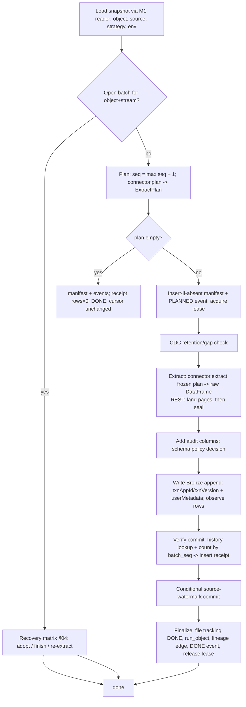

# M2 — Source-to-Bronze Execution Flow, Bronze Table Contract, Schema Evolution

## 1. End-to-end flow of one object run (`ingest_object`)

Step-level state is derived from the append-only `run_batch_event` log (doc 04). Every step is safe to repeat.

## 2. Per load type (what is planned, read, written, committed)
| Load | `plan` freezes | `extract` reads | Bronze `_op_type` | Source cursor committed |
|---|---|---|---|---|
| FULL | `wm_to` = source clock at plan time; partition bounds | whole object (partitioned) | `S` | `wm_to` timestamp (informational; used for audit and `is_complete_extract` semantics in Silver) |
| SNAPSHOT | same as FULL | whole object; **each run is a complete copy** | `S` | `wm_to` |
| INCREMENTAL | `wm_from` = committed value; `wm_to` = safe upper bound (see below); lookback | rows with `wm > wm_from−lookback AND wm <= wm_to` | `C` (changed: upsert semantics, delete **not** detectable) | `wm_to` |
| CDC (feed / SQL Server native) | LSN/seq range `(committed, hi]`; retention check result | all change events in range, in source order | `I` / `U` / `D` (before-images dropped) | `hi` (LSN/seq) |
| FILE_INCR | frozen file list (new or changed files, ≤ `max_files_per_batch`) | exactly those files | `C` | max `(mtime, path)` of listed files (optimisation only; correctness = file tracking) |
| API | window `wm_from` … (sealed `wm_to_observed` after landing) | landed pages | `C` | sealed `wm_to_observed` |
| Initial run of INCREMENTAL/API/CDC | `wm_from = NULL` (or `backfill_from`); large loads split by `max_window` into sequential batches (`max_batches_per_run`) | as above | as above | each batch commits its own `wm_to` |
Notes: FULL and SNAPSHOT differ only in intent (Silver uses `is_complete_extract` to detect deletes by absence); both land complete copies as history. **Deletes:** only CDC carries them (`D` rows with at least the key columns; other columns null for sources that don't ship them); INCREMENTAL cannot see deletes — documented limitation, remedy = periodic SNAPSHOT/FULL.

**Safe upper bound (`wm_to`) rules**
- timestamp: `min(MAX(col) in window, source_now − late_arrival_window)`; with `late_arrival_window` unset, `MAX(col)`.
- SQL Server `rowversion`: `MIN_ACTIVE_ROWVERSION() − 1`.
- integer identity: `MAX(col)`; caveat documented — gaps from rolled-back transactions are harmless, out-of-order commits are covered only by `lookback` (for integers interpreted as "re-read last N values", `lookback_window` is not applicable → use `late_arrival_window`-style lag via `read_options.id_lookback`, optional).
- If `wm_to <= wm_from` → `plan.empty = true`.

## 3. Bronze table contract
**Location:** `<catalog>.bronze.<table>` from `layer_mapping(BRONZE).target_table` (`bronze.<table>`). Created on first batch from the first extract schema; Delta properties: `delta.columnMapping.mode = name` (allows source columns with spaces/special characters — verified locally), not `appendOnly` (maintenance `OPTIMIZE/VACUUM` and erasure `DELETE` must remain possible), log/file retention from `retention_policy` when defined. No partitioning by default (`object.partition_cols` honoured when set); clustering/optimisation is an M5 tuning concern.

**Raw preservation:** source columns are written **as extracted** — original names, native types, no trimming, casting, renaming, filtering or dedupe. CSV defaults to all-string. The Bronze table is append-only *history*: rows re-read because of lookback or full/snapshot repeats are kept (each tagged with its batch) and are **not** an error (D8).

**Standard audit columns** (all prefixed `_`; source columns may not start with `_`, rule MDV-6003):
| Column | Type | Meaning |
|---|---|---|
| `_batch_id` | string | deterministic id of the batch (uuid5 of object, stream, seq) |
| `_batch_seq` | bigint | sequence within `(object, stream)`; enables cheap verification/data skipping |
| `_stream_key` | string | `live`, `backfill-<n>`, `reprocess-<n>`, `resync-<n>` |
| `_batch_type` | string | `LIVE|BACKFILL|REPROCESS|RESYNC` |
| `_execution_id` | string | run id of the pipeline run that wrote the rows (`run_pipeline.run_id`; Databricks job run id when available) |
| `_config_snapshot_id`, `_release_id` | string | immutable config used (M1) |
| `_ingest_ts` | timestamp | write time (UTC) — one value per batch |
| `_source_system`, `_source_object` | string | source code and `schema.object` |
| `_source_file`, `_source_file_mod_ts` | string, timestamp | file/landed-page origin (null for JDBC) |
| `_op_type` | string | `S` snapshot, `C` changed, `I`/`U`/`D` CDC |
| `_op_seq` | string | source sequence (LSN/seq/watermark value) as text, for ordering |
| `_row_hash` | bigint | `xxhash64` of source columns (fast change detection; Silver may compute stronger hashes) |
| `_schema_hash` | string | hash of the extracted source schema |
| `_framework_version` | string | accelerator version |
| `_rescued_data` | string | only for `schema_evolution_mode: RESCUE` |
Metadata check: `source column named like an audit column` is also verified on the discovered schema at runtime (DATA error).

## 4. Schema evolution (per `load_strategy.schema_evolution_mode`)
Compare extracted schema vs Bronze table schema before writing; record the outcome in `run_schema_snapshot` (`schema_hash`, `schema_json`, `change_type`).
| Change | FAIL | ADD_COLUMNS (default) | ALLOW_WIDENING | RESCUE |
|---|---|---|---|---|
| New column | fail batch (DATA, no retry) | add nullable column (`mergeSchema`), proceed | as ADD | as ADD |
| Column missing in source | proceed (nulls) — warn | proceed — warn | proceed — warn | proceed — warn |
| Safe type widening (int→bigint, float→double, decimal precision up, date→timestamp) | fail | fail | cast/widen, proceed* | rescue |
| Incompatible type change | fail | fail | fail | value kept as JSON in `_rescued_data`, column null |
| Renamed column | looks like drop+add; flagged `change_type=DROPPED+ADDED` for review | same | same | same |
\* Widening the **table** column type requires Delta type widening on the target runtime; locally/unsupported runtimes fall back to FAIL (G14, pending Databricks verification). Incoming narrower types are cast up to the table type without needing table change.
Failures are DATA errors → batch `FAILED_FATAL` (not retried); the operator fixes metadata (e.g., switch mode) and restarts — the same manifest/window is reused.

## 5. Idempotent writes and duplicate prevention
| Layer | Mechanism | Prevents |
|---|---|---|
| L1 batch identity | manifest insert-if-absent on `(object, stream, seq)`; open batch resumed, never re-planned | two different windows for one sequence |
| L2 Delta transaction | `txnAppId = <object>:<stream>:BRONZE`, `txnVersion = batch_seq` on the append; commit `userMetadata = {batch_id, seq, manifest_hash}` | double-append after crash/retry (replay of a committed version is skipped by Delta — **verified locally**: replay and stale versions produce no commit) |
| L3 verification | receipt only after history lookup + `count(*) WHERE _stream_key=S AND _batch_seq=N` equals observed rows (stats-based skipping makes this cheap) | silent partial/duplicate commit |
| L4 file tracking | `(object, path, mtime, size)` marked `DONE` only after receipt | re-ingesting an already-landed file; picks up re-delivered changed files |
| L5 lease (advisory) | one runner per `(object, stream)` | wasted duplicate work (correctness never depends on it) |
Not prevented by design: duplicate *source* rows from overlapping windows (lookback) or repeated snapshots — they are history; Silver dedupes using business keys + `_op_seq`/`_ingest_ts`.

## 6. Counts and verification recorded (no extra full scans)
`rows_read` and corrupt-record counts come from a Spark `Observation` attached to the write action (same pass); `rows_written` from Delta commit metrics (`numOutputRows`); mismatch between them fails the batch. Optional source-side `count(plan)` pushdown for JDBC is stored in the event payload for M4 reconciliation (not enforced in M2).

## 7. Lineage
One table-level lineage row per committed batch in `run_lineage` (source object → Bronze table, batch id). Column-level lineage is deferred.
