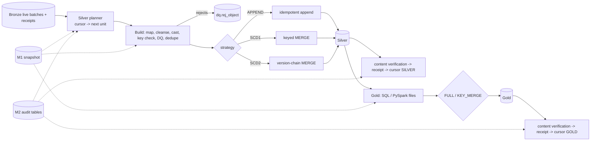

# M3 — Transformation engine (Bronze → Silver → Gold): approved design

**Status: APPROVED by the user (2026-11-04); implementation in progress on branch `m3-design`.** Baseline: M1 and M2 closed as `LOCAL_VERIFIED` (M2 tip `f6b68ad`). Companions: `01_M3_test_plan_and_estimate.md`, `02_M3_decisions_and_estimate.md` (decision register D1–D12, scope, estimate), `docs/adr/ADR-0020-m3-transformation-decisions.md`, example pack `examples/transform_example_pack/`.
Legend: **[E]** exists in M1/M2 code · **[P]** designed here · **[F]** future (not in M3).
Nothing in this document is validated on Databricks / Unity Catalog / Azure DevOps. M3 can at most reach `LOCAL_VERIFIED`; real SQL Server and Databricks validation stay `DATABRICKS_INTEGRATION_PENDING`.

## 1. Objective and principles
Prove that one framework can take Bronze data to Silver and Gold using **metadata only**, for different clients, without core changes. Batch-first; no streaming code; no LLM at runtime. Reliable and simple first; enterprise extras are M4.

## 2. Reuse of M1 / M2 (no duplication, M2 untouched)
| Need | Reused [E] | New in M3 [P] |
|---|---|---|
| Definitions | `cfg_layer_mapping` (merge_type, scd_columns, dedupe_keys/order), `cfg_column` (target_type, is_bk, cleanse_rules, default_value), `cfg_object` (business_keys, delete_mode), `cfg_transformation` (type, body_ref, input_objects, params, checksum), `cfg_dq_rule`, `cfg_pipeline_dependency`, `cfg_retry_policy`, `cfg_execution` | six additive fields (§7) |
| Immutable config | M1 snapshots + `SnapshotMetadataReader` | — |
| Batch protocol | `ManifestRepo`, `EventLog`, `ReceiptRepo`, `LeaseRepo`, `RunLog`, `open_batch`, `Manifest`, `Receipt`, `batch_id_for` | stream keys `SILVER:live`, `GOLD:main` |
| Cursor table | `wm_layer_cursor` (DDL only in M1) | `LayerCursorRepo` + column `input_versions` |
| Fault injection | `FaultInjector`, `InjectedCrash` | crash points for Silver/Gold |
| Bronze contract | audit columns `_batch_id/_batch_seq/_stream_key/_op_type/_op_seq/_row_hash/_ingest_ts`, Bronze receipts | read-only consumer |

**No M2 source file is modified.** M3 imports only this public M2 surface (enforced by an import test): `audit.repos` (`ManifestRepo`, `EventLog`, `ReceiptRepo`, `LeaseRepo`, `RunLog`, `open_batch`), `audit.models` (`Manifest`, `Receipt`, `batch_id_for`, `PLANNED`, `DONE`, `FAILED_RETRYABLE`, `FAILED_FATAL`, `ABANDONED`, `TERMINAL`), M1 reader/snapshot APIs, `TableStore`, `core.*`. Never used: underscore-prefixed names, `IngestionEngine` internals, `BronzeWriter.verify`, connectors, `ingestion.windows`. M3 relies on `EventLog.state` ignoring unknown informational events [E]; a test pins this behaviour.

**Temporary duplication (documented, tracked `M4-CONSOLIDATE-01`):** M3 has its own ≈40-line retry / failure-recording / result wrapper (mirrors `IngestionEngine.ingest_object`, `_record_failure`, `_best_effort`, `_finish`) and ≈25 lines of thread-pool/run-summary logic (mirrors `ingestion/runner.py`). M4 extracts both into a neutral package that M2 delegates to, behind the 398-test regression gate. This is a deliberate exception to governance rule 2, approved by the user.

## 3. Architecture

Packages (all new): `processing/common/` (hashing, cleansing, columns, rejects, dq, verify, unit wrapper), `processing/silver/` (planner, builder, strategies, engine), `processing/gold/` (sqlguard, loader, engine), `processing/runner.py`, `audit/layer_cursor.py`, `cli/transform.py`. Layer rule: `processing` never imports `ingestion` or `connectors`.
Extension points for streaming (not implemented): the planner returns an `InputSlice`-like unit description and merge strategies are pure functions of a staged DataFrame, so a micro-batch source could reuse them later [F].

## 4. Silver semantics [P]
**Unit planning (D1).** Eligible Bronze batches: manifests of `(object, stream "live")` with `batch_seq` greater than the Silver cursor, a Bronze receipt, and not `ABANDONED`. A lower open batch without a receipt blocks higher ones. A unit is up to 50 consecutive batches (engine constant). A batch whose Bronze manifest has `plan_json.mode == "full"` is its own unit (its candidate-absent count is reported, §6).

**Column mapping and cleansing (D2).** For each declared `cfg_column`: take the Bronze column, apply `cleanse_rules.ops` in order, then `try_cast` to `target_type`, name it `target_name` (default: same name). Allowed ops: `trim`, `upper`, `lower`, `initcap`, `nullif{values}`, `replace{from,to}` (literal), `default{value}`, `map_values{map}`, `parse_date{format}`, `parse_timestamp{format}`. Anything else is a validation error. No `expr`, no regex, no derived columns. `column_mode: PASSTHROUGH` (explicit) takes all Bronze business columns unchanged.

**Keys, rejects, DQ.** Business keys come from `cfg_object.business_keys`. A row is rejected when: a business key is null/blank after cleansing (`NULL_BUSINESS_KEY`); a non-null value fails its cast with `on_cast_error: REJECT` (`CAST_ERROR`, default; `FAIL` fails the unit instead); a DQ rule with action `QUARANTINE` fails (`DQ_<code>`); an SCD2 late arrival (`SCD2_LATE_ARRIVAL`). Basic DQ reuses M1 `cfg_dq_rule` types `NOT_NULL`, `VALID_VALUES` (`params.values`), `RANGE` (`params.min/max`); actions `QUARANTINE` → reject, `FAIL_BATCH` → fail the unit when failed% > `threshold_pct`, `LOG` → counted only. Other rule types are rejected by the validator for v3 packs (v2 packs unchanged).

**Reject table `dq.rej_<object>` (D4).** Columns: `object_code, src_batch_id, src_batch_seq, row_hash (Bronze _row_hash), reason, column_name, occurrences, unit_batch_id, reject_ts`. Identity `(src_batch_id, row_hash, reason, column_name)`, written insert-if-absent, so replay is safe. **Never** a business key, failing value or payload. **Privacy classification:** `_row_hash` is M2's 64-bit, un-keyed `xxhash64` over the raw business columns [E]. It is *not* a privacy guarantee (anyone can compute it, low-entropy rows can be guessed). Reject rows are therefore **restricted pseudonymous data**: they inherit the object's sensitivity and `personal_data` flag (M1 rules 3022/3023 then require a subject key and retention); access = engine + stewards (same grants as Silver, an external control, not validated here); retention must not exceed the Bronze batch they point to; the future erasure engine must delete matching reject rows [F]. A keyed HMAC reference is an M4 option.

**Dedupe.** SCD1/APPEND: latest row per business key within the unit by `dedupe_order` (only `<column> [asc|desc]` lists over declared columns), tie-broken by `_op_seq desc, _batch_seq desc, _ingest_ts desc, _row_hash`. SCD2: only exact duplicates of a logical change are collapsed (§4.2); intermediate versions in a unit are kept.

**Hashing.** `_content_hash` = SHA-256 of `to_json(struct(<target columns>), ignoreNullFields=false, timeZone=UTC)`. Silver never relies on the Bronze 64-bit hash for correctness.

**Delete scope (D12).** Deletes come from Bronze `_op_type = 'D'` rows only. Behaviour by `cfg_object.delete_mode`: `soft` → `_is_deleted = true`, `_deleted_ts`; `hard` → physical delete (SCD1 only; rejected for SCD2 and APPEND); `ignore` → delete rows dropped. APPEND with `soft` appends a tombstone row. **No implemented connector produces `D` rows** (CDC is future [F]), so M3 tests deletes with synthetic Bronze batches written through the real Bronze writer, and **source deletes from JDBC sources do not reach Silver in M3** (known limitation). Delete-by-absence is deferred to M4 (§6).

### 4.1 SCD1 / APPEND
SCD1: one MERGE on the business key; update only if the incoming row is newer by `(_effective_ts, _src_batch_seq)` and its `_content_hash` differs (or the target row is deleted and the incoming is an upsert); insert if absent. `_effective_ts` = `effective_column` if configured (else `_ingest_ts`). APPEND: idempotent Delta append (`txnAppId`, `txnVersion = unit seq`).

### 4.2 SCD2
Target columns add `_sk` (string, 128-bit hex), `_scd_hash` (SHA-256 of the tracked `scd_columns`), `_valid_from`, `_valid_to` (null = open), `_is_current`.
- **Logical change identity (LCI)** = `(business key, _scd_hash, _effective_ts)`, independent of batch. `_sk = hex128(SHA-256(LCI))`. A version whose LCI already exists is a duplicate and is dropped (counted) — this makes replay within a batch and re-delivery across batches no-ops.
- **Consecutive identical states collapse:** if the tracked hash equals the current version's hash, no new version is created even if the effective time advanced; non-tracked columns are updated in place on the current version.
- **Recurrence** A→B→A creates three versions.
- **Order** within a key: `(_effective_ts, _src_batch_seq, _op_seq, _scd_hash)` (total order). **Same effective time, different hash:** both versions are kept; the earlier is closed with `_valid_to = _valid_from` (a zero-length version, retained for audit; point-in-time reads use `_valid_from <= t < _valid_to`, so it is never returned).
- **Late arrival:** an incoming version with `_effective_ts` strictly older than the key's newest `_valid_from` is rejected to the reject table (`SCD2_LATE_ARRIVAL`, counted) — never lost, never halting. Late arrivals *within one unit* are ordered chronologically and are not late. Documented semantic: when effective times are out of order across batches, results depend on unit boundaries; the default policy makes this visible.
- **Deletes:** soft → close the current version and insert a tombstone version (`_is_deleted = true`); a reappearance opens a new version after it. Hard delete is rejected for SCD2.
- History restatement is out of scope.

## 5. Gold semantics [P]
**Trust model (D6) — Gold SQL/PySpark are code, not metadata.**
1. Only **reviewed files** run: `cfg_transformation.body_ref` is a relative path under the deployment-configured `transform_root`; the file's SHA-256 must equal the active release's `checksum` (recorded at pack build, insert-only, approved release). Path is resolved and must stay inside `transform_root` (no `..`, no symlink escape).
2. **`inline_sql` is rejected** (validator + runtime). No SQL text stored in a metadata table is ever executed.
3. Values never become SQL text: parameters are declared, typed (`string|int|decimal|date|bool`) and bound as `:name` markers. Placeholders `{{ input.<obj> }}` / `{{ step.<n> }}` resolve only to engine-generated view names for **declared** `input_objects`.
4. A small tokenizer (not a SQL parser) strips comments/strings and requires the first keyword to be `SELECT` or `WITH`; it rejects `;` and standalone `INSERT/UPDATE/DELETE/MERGE/DROP/CREATE/ALTER/TRUNCATE/GRANT/REVOKE/OPTIMIZE/VACUUM`. It can over-block (a column named `update`; reviewers can quote it). **Defence in depth, not a security boundary.**
5. PySpark files (`transform(inputs, params, ctx) -> DataFrame`) are code deployments loaded with `importlib` from `transform_root` under the same checksum/path rules; they run with the job's permissions.
6. Boundary: whoever can change both the deployment files and the release metadata can run arbitrary code (as with any pipeline code). Restricting metadata-table write access, branch policy and job-principal grants are external controls, **not validated here**.

**Write modes (D7).** `merge_type: OVERWRITE` = FULL (atomic replacement), `merge_type: MERGE` = KEY_MERGE (upsert on business keys; rows not produced this run are *not* removed — use FULL). CDF is designed but deferred; `{{ delta.* }}` and `incremental_mode: CDF` are rejected by the validator.

**Version recording and no-change skip.** At planning the engine resolves each input Silver table's head Delta version and stores `{input: version}` in the manifest `plan_json` plus a `logic_hash` (transform checksums + params + key/merge settings). Inputs are read `VERSION AS OF` those versions. If every head equals the cursor's `input_versions` **and** the logic hash equals the last committed Gold unit's, the result is `NO_DATA` (no manifest, no commit). Non-data commits (OPTIMIZE, VACUUM, ADD COLUMNS) bump versions and cause a harmless extra recompute. Pinned versions require Silver `VACUUM` retention to exceed the longest Gold lag (documented dependency; a vacuumed version fails the unit with a clear error and `replan` re-pins).

**Gold cursor meaning.** Silver: `applied_seq` = last consumed Bronze `batch_seq`. Gold: `applied_seq` = last committed Gold unit sequence (stream `GOLD:main`), `input_versions` = `{input_object: consumed Delta version}`.

**Runner (D9).** Topological levels from `cfg_pipeline_dependency` + declared inputs; objects in a level run in parallel (thread pool); a failed upstream makes HARD dependents `SKIPPED_UPSTREAM_FAILED`, SOFT dependents proceed.

## 6. Deferred: delete-by-absence (M4 specification)
Not implemented in M3. Silver only *reports* the candidate-absent key count of a `mode == "full"` unit in an event payload (no data change). Reason: completeness of a JDBC extract cannot be proven — M2 rejects `isolation_level` [E] (no consistent-snapshot guarantee on SQL Server), partitioned reads are only tested on static in-bounds data, and hidden source-side filtering is undetectable.
M4 requirements: connector attestation `plan_json.scope == "complete"` only for an unfiltered read under a consistent snapshot with an immutable partition column or a single query, with contract tests against real databases (including rows outside frozen partition bounds); Silver additionally requires `mode == "full"` in the Bronze manifest and `rows_read == rows_written` in the Bronze receipt (configuration is never consulted).
**Delete guard (M4):** N = live keys before the unit; K = distinct non-null business keys of the snapshot (after cleansing, before rejects; a row rejected for a non-key reason still counts as present); D = live keys not in K. Breach iff `N > 0 and (K is empty or D*100 > delete_guard_pct*N)` (integer arithmetic; ratio exactly equal to the percentage is allowed; percentage 100 never breaches by ratio but the empty rule still applies; `N = 0` no guard). A breach fails the unit before any merge; override = metadata release changing `delete_guard_pct` (no ad-hoc approval workflow in M3).

## 7. Metadata schema v3 (additive migration 0003; 0001/0002 frozen)
| Table | New column |
|---|---|
| `cfg_column` | `target_name` |
| `cfg_layer_mapping` | `effective_column`, `on_cast_error` (REJECT default \| FAIL), `column_mode` (DECLARED default \| PASSTHROUGH) |
| `wm_layer_cursor` | `input_versions` (json) |
| bootstrap YAML | `transform_root` |
Table count stays 53. Validator rules **MDV-7xxx** (new module `rules_transform.py`), active only for packs with `metadata_schema_version >= 3` so v2 packs and `acme_pack` keep validating: SILVER mapping needs declared columns or `column_mode: PASSTHROUGH`; business keys declared for MERGE/SCD; `effective_column`/`dedupe_order` reference declared columns; cleanse ops/params valid (allowlist); `on_cast_error` valid; hard delete not with SCD2/APPEND; Gold needs transformation steps with known inputs; transformation type SQL/PYSPARK only (`BUILTIN` and `inline_sql` rejected); file present and checksummed (reuses 2010/2011); `incremental_mode`/CDF rejected; DQ rule types limited to `NOT_NULL, VALID_VALUES, RANGE` with actions `LOG/QUARANTINE/FAIL_BATCH`; layer mapping `target_table` authoritative (agree with `cfg_object.target_*` when both set).
Backward compatibility: all new fields nullable with defaults; a v2 pack loads on a v3 core; a v3 pack is refused by a v2 deployment through the existing `check_compat` gate; migrations 0001/0002 checksums unchanged (golden tests).

## 8. Recovery and content verification (D11)
**Change request to doc 08 / ADR-0009 (approved):** for MERGE-type targets, recovery uses **data-idempotent merges plus content-level verification**, not commit tagging or session isolation (the 2026-11-04 spike showed a replayed MERGE leaves identical data and the tag conf is not thread-safe in a shared session). Append writes keep Delta transaction-id idempotency. The invariant "cursor advances only after a verified commit" is unchanged.

**Unit protocol (Silver; Gold is identical with different input/outputs).** `recover` via `open_batch` → plan (cursor, eligible batches) → insert-once manifest (`wm_from/wm_to` = Bronze seq range, `plan_json` = Bronze table, batch ids, logic hash) → `PLANNED` → lease → build → **merge** → **verify** → receipt (`layer=SILVER`) → event `TARGET_COMMITTED` (counters) → conditional cursor advance (`LayerCursorRepo.advance`, precondition on previous `applied_seq`) → event `CURSOR_ADVANCED` → `DONE` → release lease. Recovery decides from durable facts: manifest without receipt → rebuild, re-merge (a data no-op if already applied), verify; receipt without cursor move → advance only; cursor moved without `DONE` → finish bookkeeping.

**Verification (S = staged result, T = target after the merge; single writer per object by lease; `_content_hash` = SHA-256 of declared columns):**
| Strategy | Must hold or the unit fails and the cursor does not move |
|---|---|
| APPEND | rows for the `_src_batch_seq` range match staged rows by count **and** order-independent sum of per-row content hashes |
| SCD1 | every staged key: target `_content_hash` and ordering equal staged, or ordering strictly newer; no duplicate key |
| SCD2 | every new staged version exists by `_sk` with equal `_scd_hash`/`_valid_from`; per touched key each `_valid_to` equals the next `_valid_from`, exactly one current row, last has `_valid_to` null; newest version's untracked values match staged hash |
| soft delete | key present with `_is_deleted = true` and expected `_deleted_ts`; SCD2: tombstone version, previous version closed, no current non-deleted version |
| hard delete (SCD1) | key absent |
| Gold FULL | content checksum of the result (collected during the write with a Spark observation: count + order-independent sum of per-row hashes) equals the same checksum over T |
| Gold KEY_MERGE | every staged key exists in T with equal `_content_hash`; no duplicate key |
Only the final state per key within a unit is verified. Row counts are used for reconciliation counters only (`rows_in = applied + deduped + rejected`; a mismatch fails the unit), never as proof of content.

**Crash points (6):** before manifest · after manifest · after build, before merge · after merge, before receipt · after receipt, before cursor advance · after cursor advance, before `DONE`.

## 9. Error handling
Classes reuse the M2 taxonomy: TRANSIENT (Delta conflicts — already retried in the store — timeouts) retried per `cfg_retry_policy`, each retry starting with recovery; DATA (verification mismatch, cast error under `FAIL`, DQ `FAIL_BATCH`) not retried, unit `FAILED_FATAL`; CONFIG (checksum mismatch, vacuumed pinned version, missing key) not retried; LOGIC contained per object. A failed Silver unit leaves Bronze untouched (no re-extraction); HARD-dependent Gold objects are skipped. Operator action: `transform-replan` abandons an uncommitted unit (layer-aware receipt check) so it is re-planned under the current snapshot; the actor name is free text (like M2 `abandon-batch`) and is **not** authenticated. There is no data-skip action in M3.

## 10. Scope boundaries and known limitations
Not in M3 (M4 or later): delete-by-absence and connector attestation, operator approval workflow and data-skip, keyed (HMAC) reject references, Gold CDF and CDF change detection, advanced schema evolution (only `ADD COLUMN`; rename/drop/narrowing fail the unit), built-in transforms, `expr`/regex/derived columns, automated rebuild (M3 is forward-only; manual procedure: freeze object, archive target, create a replacement object/target via a metadata release, let it consume Bronze from seq 1, verify, cut over — requires Bronze retention to cover the history), DQ scoring and reconciliation engine, planner/DAG, erasure/retention automation, streaming, Databricks/Unity Catalog/Azure DevOps validation, scale. Personal-data copies in Silver/Gold/rejects exist; erasure is not automated [F]. M1's `--approved-by` and M2's `--actor` remain unauthenticated labels (pre-existing).
