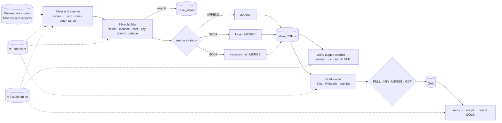

# M3 — Transformation Engine (Bronze → Silver → Gold): Architecture and Design

**Status: PROPOSED — awaiting your review. No M3 code exists.** Baseline: M1 and M2 closed as `LOCAL_VERIFIED` (commit `51270e6`). Companion: `01_M3_test_plan_and_estimate.md`, `docs/adr/ADR-0020-m3-transformation-decisions.md`, example pack `examples/transform_example_pack/`.

## 1. M1 / M2 integration assessment

### 1.1 What already exists and is reused unchanged
| Need | Existing asset | Notes |
|---|---|---|
| Transformation definitions | M1 `cfg_layer_mapping` (`merge_type` APPEND/MERGE/SCD1/SCD2/OVERWRITE, `scd_columns`, `dedupe_keys`, `dedupe_order`, `target_table`), `cfg_transformation` (`step_no`, `type` SQL/PYSPARK/BUILTIN, `body_ref`, `input_objects`, `params`, auto-filled `checksum`), `cfg_column` (`target_type`, `is_bk`, `cleanse_rules`, `default_value`, FK), `cfg_object` (`business_keys`, `delete_mode`, `enabled_layers`, `object_kind: derived`), `cfg_pipeline_dependency` (HARD/SOFT) | metadata for M3 is largely **already modelled** |
| Config validation | 65 rules incl. 3005 (MERGE/SCD need keys), 3006 (SCD2 needs `scd_columns`), 3009/3010 (layer mapping ↔ enabled layers), 3024/3025 (transformation steps), 2010/2011 (file present, checksum), 6002 (layer table prefix) | new MDV-7xxx rules extend, never replace |
| Immutable config per run | M1 snapshots + typed readers (`SnapshotMetadataReader`) | engines read only the snapshot, as in M2 |
| Release/rollback, compatibility | M1 release manager, schema versioning, migration framework | schema v3 is an additive migration |
| Batch protocol | M2 `audit` repositories: manifest, event log, receipts, conditional watermark, lease, run log; recovery-first engine pattern; `FaultInjector`; crash-matrix harness | reused with a stream-key convention (§3) |
| Bronze contract | `_batch_seq`, `_stream_key`, `_batch_type`, `_op_type` (S/C/I/U/D), `_op_seq`, `_row_hash`, `_ingest_ts`, `_source_file`; receipts per Bronze batch | Silver's input interface |
| Store robustness | Delta store: tz-aware timestamps, bounded conflict retry | already fixed in M2 closure |
| Test infrastructure | `build_world`, Delta-audit fixtures, `MockConnector`, real PostgreSQL integration fixture | M3 tests start on the Delta audit store (lesson of the M2 review) |
| Independent layer cursor | M1 table `wm_layer_cursor` (DDL_ONLY) | M3 activates it |

### 1.2 Gaps and conflicts found (and how each is resolved)
| # | Finding | Resolution |
|---|---|---|
| G1 | M1 `cfg_column.cleanse_rules` is a JSON **object**; a list of operations is rejected by the validator (found by validating the example pack) | Ordered operations live under an `ops` key: `cleanse_rules: {ops: [{op: trim}, …]}` — **no schema change** |
| G2 | No way to rename a column or define a derived column | additive `cfg_column.target_name`, `cfg_column.expression` |
| G3 | `cfg_layer_mapping` lacks the SCD2/ordering column, cast-error policy, late-arrival policy, incremental mode, batch cap | additive columns (§3) |
| G4 | `wm_layer_cursor` has no per-input version map (needed for Gold change-feed increments) and no stream key | additive `input_versions json`; **Silver consumes the `live` Bronze stream only** (resolves M2 gap G9); backfill / reprocess / resync Bronze batches are applied by an explicit command |
| G5 | Retry loop, attempt/result recording, best-effort audit and `ObjectResult` live inside `IngestionEngine`; Bronze commit lookup lives in `BronzeWriter.verify` | extract into shared helpers (`ingestion/execution.py`, `processing/common/delta_commit.py`) — **behaviour-preserving refactor**, existing M2 tests are the safety net. Avoids duplicating the protocol |
| G6 | `run_batch_manifest` is keyed by (object, stream, seq) and has no layer | reuse with `stream_key = "SILVER:live"` / `"GOLD:main"`; receipts already carry `layer` — **no schema change** |
| G7 | M1 keeps only transform-file *checksums*; the runtime needs the file contents | new bootstrap setting `transform_root`; files are read from there and **checksum-verified against the metadata** before use |
| G8 | **Spike S1 (local Delta 3.2, done 2026-11-04):** a MERGE commit *can* be tagged and found in history, **but** (a) a replayed MERGE with an ordering guard leaves the data identical yet still writes a new commit (no transaction-id de-duplication as for appends); (b) the tag is a **session-level** setting and is **not thread-safe** — two threads in one session got each other's tag; one `spark.newSession()` per concurrent unit isolates it (3/3 rounds); (c) change data feed works on a MERGE-maintained table (pre/post images, commit versions) | Recovery **looks for the tag first**, then merges; data-level idempotency (key + ordering guard + hash) is the safety net; every unit runs in its own isolated session; the tag is always unset in `finally` |
| G9 | No DQ engine yet (M4) but cast failures / null keys need somewhere to go | minimal reject tables `dq.rej_<object>` (append, idempotent); M4 builds on them |
| G10 | Gold objects depend on Silver objects; the advanced planner is M4 | M3 runner orders work by simple topological levels from `cfg_pipeline_dependency` — **not** a planner |
| G11 | Real SQL Server / Databricks validation still pending (M2) | M3 is likewise `LOCAL_VERIFIED` only; validated locally on real Delta and the real PostgreSQL → Bronze path |

## 2. Architecture and components



### 2.1 Packages (new code under existing top-level packages)
| Package | Content |
|---|---|
| `processing/common/` | `cleansing.py` (operation vocabulary → Spark columns), `casting.py`, `dedupe.py`, `keys.py`, `rejects.py`, `delta_commit.py` (tag/lookup/verify, isolated-session scope) |
| `processing/silver/` | `planner.py` (units), `builder.py`, `scd1.py`, `scd2.py`, `engine.py` |
| `processing/gold/` | `loader.py` (SQL / PySpark / built-ins), `cdf.py`, `engine.py` |
| `processing/runner.py` | layer-ordered, parallel-within-level runner (reuses M2 runner mechanics) |
| `ingestion/execution.py` | extracted shared retry/result/best-effort helpers |
| `cli` | `transform --execution X [--layer SILVER\|GOLD] [--objects …] [--restart]`, `transform-status --object O --layer L` |

Dependency rule (import-linter): `cli → processing → audit/metadata(reader) → core`; Silver/Gold never import connectors or the ingestion engine (they see Bronze only through tables and M2 receipts).

### 2.2 Key abstractions (extension points)
- **`InputSlice`** — "the input of one unit": today a Bronze batch range `(stream, seq_from, seq_to)`; for Gold, a map of Silver table → Delta version range. Streaming would later supply a micro-batch slice; **no streaming code in M3**.
- **`MergeStrategy`** registry — `Append`, `Scd1`, `Scd2`, `Overwrite`, `KeyMerge`: pure functions *(staged DataFrame, target, mapping) → merge statements*; usable unchanged from `foreachBatch` later.
- **`Transform`** registry — `SqlTransform`, `PySparkTransform`, `BuiltinTransform` (extension through registered interfaces only, as for connectors).

### 2.3 Silver semantics (metadata-driven)
**Input selection.** Bronze batches of stream `live` that have a Bronze receipt and `batch_seq > cursor`, in order. A lower, still-open (non-terminal) batch blocks later ones (ordering preserved); abandoned sequence numbers are skipped. Units never mix a **complete-extract** batch (FULL/SNAPSHOT) with others: a complete extract is its own *snapshot unit* (enables delete-by-absence); other batches are grouped into *delta units* of at most `max_batches_per_unit`.

**Cleansing and standardisation** (per column, ordered, from `cleanse_rules.ops`): `trim`, `upper`, `lower`, `initcap`, `nullif{values}`, `replace{from,to}`, `regex_replace{pattern,to}`, `default{value}`, `map_values{map,default}`, `parse_date{format}`, `parse_timestamp{format}`, `expr{sql}` (single Spark SQL expression, reviewed in Git). Type conversion = `target_type` via `try_cast`; a non-null value that fails the cast is a **cast error** handled by `on_cast_error` (`REJECT` default → row to the reject table with reason; `NULL`; `FAIL` → batch fails). Derived columns via `expression`; renames via `target_name`. A column list may be empty: the object then passes through all Bronze business columns unchanged (pass-through mode).

**Keys.** `business_keys` must be non-null/non-blank after cleansing, else the row is rejected (`reason=NULL_BUSINESS_KEY`). `primary_keys` stay informational. Deterministic surrogate keys (`xxhash64` of business key [+ `_valid_from` for SCD2]) — no identity columns, so reruns are reproducible.

**Duplicate handling.** Within a unit, latest row per business key by `dedupe_order` (e.g. `ModifiedDate desc`), tie-broken by `_op_seq desc, _batch_seq desc, _ingest_ts desc`. Overlap duplicates from the M2 lookback (identical rows) collapse here and are no-ops downstream (same `_row_hash`).

**Strategies.**
- `APPEND` — idempotent append (`txnAppId/txnVersion`, as Bronze).
- `SCD1` — one MERGE on business key: update only if the incoming row is newer by the ordering guard (`_effective_ts`, then `_src_batch_seq`) **and** `_row_hash` differs; insert if absent; deletes per `delete_mode`.
- `SCD2` — per key, versions ordered by effective time (`effective_column`, default `_ingest_ts`), consecutive identical `_scd_hash` (hash of `scd_columns`) collapsed; versions already present in the target (same key + `_valid_from`) are dropped (idempotent replay); the previous current row is closed (`_valid_to`, `_is_current=false`) and new versions inserted in one MERGE (merge-key trick). An incoming version **older than** the target's newest `_valid_from` is a *late arrival*: `late_arrival_policy: FAIL` (default, batch fails with a DATA error) or `REJECT`. Restating history (re-deriving a key's chain) is **out of scope for M3**.
- `OVERWRITE` (Gold) — atomic full replacement, tagged and verified.

**Deletes.** `delete_mode` from `cfg_object`: `soft` → `_is_deleted=true`, `_deleted_ts`; `hard` → physical delete; `ignore`. Triggers: Bronze `_op_type='D'` rows (arrive with CDC, a future capability) and **absence from a complete-extract snapshot unit** (when `is_complete_extract`). SCD2 deletes close the current version.

**Silver table contract.** Declared columns (target names/types) + `_src_batch_seq`, `_src_batch_id`, `_effective_ts`, `_row_hash`, `_silver_run_id`, `_silver_ts`, `_is_deleted`, `_deleted_ts`; SCD2 adds `_sk`, `_scd_hash`, `_valid_from`, `_valid_to`, `_is_current`. Created with Delta change data feed enabled (needed by Gold increments) and column mapping.

### 2.4 Gold semantics
A Gold object is `object_kind: derived`, with `transformation` steps over **input objects** (Silver or other Gold). Steps run in `step_no` order; each step's output is a named temp view; the last step is the result.
- **SQL**: placeholders `{{ input.<obj> }}` (full table), `{{ current.<obj> }}` (current, non-deleted rows of an SCD2/SCD1 table), `{{ delta.<obj> }}` (changed rows since this object's cursor — change data feed), `{{ step.<n> }}`; **values** are passed with Spark parameter markers (`:name` from `params`), never string-concatenated. Placeholders resolve to generated view names, not free text.
- **PySpark**: a file in `transform_root` defining `transform(inputs, params, ctx) -> DataFrame`; loaded only after its SHA-256 equals `cfg_transformation.checksum`; no inline Python in YAML.
- **Built-ins** (small, generic): `select`/`rename`, `filter`, `aggregate`, `surrogate_key`, `current_rows`.
- **Incremental modes** (`incremental_mode`): `FULL` (default; recompute and OVERWRITE), `KEY_MERGE` (recompute, MERGE on business key), `CDF` (only inputs' changed rows via `{{ delta.* }}`; cursor stores each input's last consumed Delta version in `input_versions`; target MERGE on key). Documented limit of `CDF`: a change in a *non-driver* input does not re-derive existing rows (use `FULL`).
- Dependency order: topological levels from `cfg_pipeline_dependency` + declared inputs; a failed Silver object marks HARD-dependent Gold objects `SKIPPED_UPSTREAM_FAILED`; SOFT dependents run on the current Silver state.

## 3. Metadata schema changes (additive migration `0003`, schema v3; `0001`/`0002` unchanged and pinned)
| Table | New columns |
|---|---|
| `cfg_column` | `target_name`, `expression` |
| `cfg_layer_mapping` | `effective_column`, `on_cast_error` (NULL \| REJECT \| FAIL, default REJECT), `late_arrival_policy` (FAIL \| REJECT, default FAIL), `incremental_mode` (CURSOR \| FULL \| KEY_MERGE \| CDF; default CURSOR for Silver, FULL for Gold), `max_batches_per_unit` (default 50) |
| `wm_layer_cursor` | `input_versions` (json), `unit_seq` |
| bootstrap config (YAML) | `transform_root` |
| *no change* | `run_batch_manifest` / `run_batch_event` / `run_target_receipt` / `run_object` / `run_pipeline` (reused; layer encoded in `stream_key` and `layer`) |
New validator rules **MDV-7xxx** (all "reject what is not implemented" in the spirit of M2): SCD2 needs a resolvable effective column and `scd_columns` declared in `cfg_column`; business keys declared; unique `target_name`; cleanse ops/params valid; `expression` columns well-formed; Silver mapping requires the Bronze layer; Gold inputs exist and are Silver/Gold; transform file present and checksummed (reuses 2010/2011); `CDF` mode requires a driver input and key; unsupported combinations (e.g. SCD2 on Gold, restate policies, streaming) rejected.

## 4. Example configuration
Complete, validated example (SCD2 customers, SCD1 orders, CDF Gold fact, full-refresh Gold dimension): `examples/transform_example_pack/`. **Validation evidence:** with the eight proposed new fields removed it passes the current M1/M2 validator for DEV with 0 errors and 0 warnings (it first failed twice, correctly: the `cleanse_rules` shape, then the missing subject-key/retention governance for a personal-data object). Extract:
```yaml
- object: customers
  layer: SILVER
  target_table: silver.customers
  merge_type: SCD2
  scd_columns: [email, country]
  dedupe_keys: [CustomerID]
  dedupe_order: "ModifiedDate desc"
  effective_column: ModifiedDate          # new (v3)
  on_cast_error: REJECT                   # new (v3)
  late_arrival_policy: FAIL               # new (v3)
```
```yaml
- {object: customers, name: Country, target_type: string, target_name: country,
   cleanse_rules: {ops: [{op: trim}, {op: upper}, {op: map_values, map: {UK: GB}}, {op: default, value: UNKNOWN}]}}
```

## 5. End-to-end execution flow
**Runner** (`de-accel transform --execution daily_all`): build and persist the M1 snapshot → `run_pipeline` row → level 0: all Silver objects in parallel (thread pool, per-unit isolated Spark session, per-object lease) → level 1…n: Gold objects in dependency order, parallel within a level → summary / exit code.

**Silver unit** (one object):
1. `recover()` — resume an open unit of `(object, "SILVER:live")` (manifest + events), else plan.
2. Plan: read cursor (`wm_layer_cursor`), list receipted Bronze batches after it, cut one unit (rules in §2.3). Empty → `NO_DATA` (no batch, no commit).
3. Insert-once manifest (`wm_from/wm_to` = Bronze seq range, `plan_json` = Bronze table, snapshot id, strategy) → `PLANNED`; lease.
4. **If a commit tagged with this unit already exists → skip to step 7** (replay-safe).
5. Build: select Bronze rows of the range → cleanse/cast → key check (rejects) → dedupe → effective time / hashes.
6. Merge in an isolated session with the commit tag; unset the tag in `finally`.
7. Verify (history tag + count by `_src_batch_seq` range) → receipt (`layer=SILVER`) → `SILVER_COMMITTED`.
8. Conditional cursor update `applied_seq := seq_to` (precondition on the previous value) → events → lineage (Bronze table → Silver table) → `DONE` → release lease.

**Gold unit:** same skeleton with `InputSlice` = Silver version ranges: resolve inputs → run steps → write by `incremental_mode` → verify → receipt (`layer=GOLD`) → conditional cursor update incl. `input_versions`.

## 6. Error handling and recovery
| Class | Examples | Behaviour |
|---|---|---|
| TRANSIENT | Delta commit conflict (already retried in the store), cluster loss, timeouts | retry per `cfg_retry_policy`; each retry first runs `recover()` |
| DATA | cast errors under `FAIL`, SCD2 late arrival under `FAIL`, key violations beyond reject policy, integrity mismatch | no retry; unit `FAILED_FATAL`; operator fixes data/metadata and re-runs with `--restart` |
| CONFIG | invalid SQL, missing/changed transform file (checksum mismatch), unresolved placeholder | no retry; fatal; caught earlier by CI validation where possible |
| PLATFORM | permission denied | no retry; page |
| LOGIC | unexpected exception | contained per object; never aborts the run (M2 safety net reused) |

**Independence and no re-extraction:** a failed Silver unit leaves the Bronze watermark and data untouched (the layers share no cursor); Bronze keeps accumulating; the Silver cursor simply does not move. HARD-dependent Gold objects are skipped, others proceed.

**Recovery matrix (Silver unit)** — durable facts decide, never memory: no manifest → plan; manifest only → rebuild and merge (data-idempotent); **tagged commit but no receipt → verify and write the receipt (no second merge)**; receipt but cursor not moved → advance the cursor only; cursor moved but no `DONE` → finish bookkeeping. Crash points tested: before manifest · after manifest · after lease · after build, before merge · after merge, before receipt · after receipt · after cursor · before `DONE` (same harness as M2, on the **Delta audit store**). Double-apply safety net if history is unavailable: key + ordering guard + hash make a repeated MERGE a data no-op.

**Concurrency:** one lease per `(object, layer)`; a unit runs in `spark.newSession()` so the commit tag cannot leak between threads; Delta conflicts are absorbed by the store's bounded retry.

## 7. Scope boundaries
In M3: batch Bronze→Silver→Gold, SCD1/SCD2, deletes (soft/hard/by absence), independent cursors, SQL/PySpark/built-in transforms, rejects table, CLI, runner with dependency levels, tests. **Not in M3:** streaming (hooks only), DQ rules/scoring/quarantine engine and reconciliation (M4), planner/DAG/`for_each` orchestration (M4), semantic layer, SCD2 history restatement, CDC-specific ingestion (future M2 capability — Silver already understands `_op_type`), Databricks/Unity Catalog validation (pending, as for M2), any LLM dependency.
